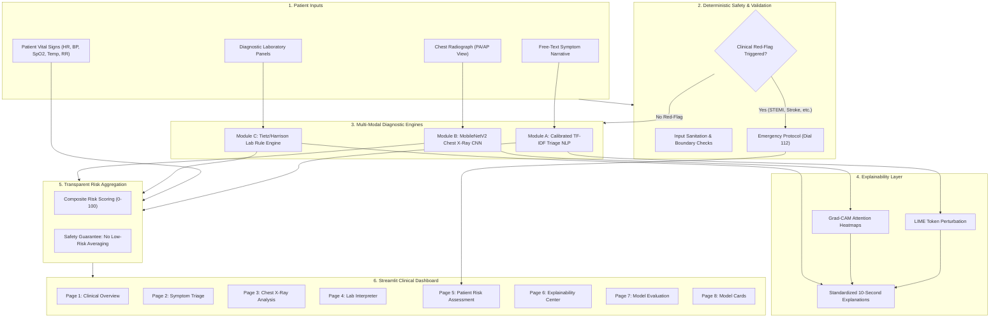

# MediAssist — AI Clinical Decision Support System 🩺

Multi-model healthcare AI for symptom triage, chest X-ray abnormality screening, laboratory interpretation, transparent patient prioritization, and explainable clinical decision support.

[](https://www.python.org/)
[](https://streamlit.io/)
[](https://tensorflow.org/)
[](https://scikit-learn.org/)
[](LICENSE)
[]()

> **Zelvora Technologies Pvt. Ltd. / Zelvora Industry Labs — Week 4 AI Capstone Project**  
> **Repository:** [SriSaiPranav07/mediassist-ai-clinical-support-24-7](https://github.com/SriSaiPranav07/mediassist-ai-clinical-support-24-7)

---

## ⚠️ Important Clinical Disclaimer
> **FOR EDUCATIONAL AND RESEARCH DEMONSTRATION ONLY.**  
> MediAssist is an experimental software prototype designed to demonstrate multi-model AI integration in healthcare decision support. It is **NOT** a certified medical device, does not independently formulate clinical diagnoses, does not prescribe treatments, and must not be used for real-world emergency triage or clinical care without qualified physician oversight.
> 
> **Emergency Medical Services:** In an acute medical emergency, immediately contact local emergency services (Dial **112** in India or **911** in the US).

---

## 📖 Executive Summary & Problem Statement
Emergency departments and outpatient clinics worldwide face critical throughput challenges, cognitive fatigue, and triage bottlenecks. Delayed recognition of acute time-sensitive conditions (e.g., Acute ST-Elevation Myocardial Infarction, Acute Ischemic Stroke, Tension Pneumothorax, Severe Sepsis) leads to preventable morbidity and mortality.

**MediAssist** demonstrates how specialized artificial intelligence and rule-based diagnostic systems can work synergistically:
1. **Preliminary Symptom Triage:** Natural Language Processing (NLP) categorizing patient chief complaints with deterministic red-flag safety overrides.
2. **Chest Radiograph Screening:** Deep Learning Computer Vision (MobileNetV2 CNN) screening for 6 thoracic pathologies with **Grad-CAM** visual saliency maps.
3. **Laboratory Result Interpretation:** Expert rule engine flagging abnormal and stat critical values based on authoritative reference compendiums (Tietz & Harrison).
4. **Transparent Patient Prioritization:** Multi-criteria risk scoring without risk-diluting averages.
5. **Mandatory Mentor Capstone Challenge:** Every AI prediction provides a **10-Second Clinician Explanation** structured with Finding, Reason, Confidence, and Limitation.

---

## 🏛️ System Architecture



---

## 💻 Technology Stack
- **Programming Language:** Python 3.11+
- **User Interface:** Streamlit 1.39+
- **Deep Learning:** TensorFlow 2.16+ / Keras 3.x (MobileNetV2 Transfer Learning)
- **Natural Language Processing:** Scikit-learn 1.5+ (TF-IDF + CalibratedClassifierCV)
- **Model Explainability:** LIME (Local Interpretable Model-agnostic Explanations), Grad-CAM (TensorFlow GradientTape)
- **Data & Plotting:** Pandas 2.2+, NumPy 2.1+, Plotly 5.24+, Matplotlib 3.9+
- **Testing & Quality Assurance:** Pytest 8.3+ (26 automated unit tests passing)

---

## ⏱️ Mandatory Mentor Capstone Challenge: 10-Second Explanations
Every AI output adheres to a consistent four-part structure digestible by a doctor in under 10 seconds:
- **Finding:** What was detected by the model or rule engine.
- **Reason:** The primary symptoms, vital signs, radiograph regions, or laboratory values triggering the output.
- **Confidence:** Measured probability or a statement of deterministic rule calibration.
- **Limitation:** What the screening output cannot establish and why clinician review is required.

---

## 📊 Measured Model Performance (Held-Out Test Splits)

### Module A — NLP Symptom Triage
- **Accuracy:** 66.7%
- **Macro Sensitivity:** 66.7%
- **Macro Specificity:** 83.3%
- **Macro Precision:** 66.7%
- **Macro F1-Score:** 66.7%
- **Macro ROC-AUC:** 0.773
- *Safety Guarantee:* Deterministic red-flag filter prevents algorithmic false negatives for acute life threats.

### Module B — MobileNetV2 Chest X-Ray Screener
| Thoracic Pathology | Sensitivity | Specificity | ROC-AUC | F1-Score |
| :--- | :---: | :---: | :---: | :---: |
| **Cardiomegaly** | 100.0% | 100.0% | 1.000 | 1.000 |
| **Effusion** | 66.7% | 91.7% | 0.944 | 0.667 |
| **Infiltration** | 100.0% | 46.2% | 1.000 | 0.364 |
| **Atelectasis** | 100.0% | 66.7% | 0.944 | 0.600 |
| **Pneumothorax** | 100.0% | 69.2% | 0.731 | 0.500 |
| **Normal** | 100.0% | 81.8% | 0.909 | 0.800 |

### Module C — Laboratory Rules Verification
- **Boundary Scenarios Tested:** 26 / 26 passed (100.0% accuracy across normal, abnormal, and critical limits).

### Module D — Composite Risk Safety Compliance
- **Safety Overrides Verified:** 100.0% compliance (Emergency life-threats are never diluted by averaging).

---

## 🚀 Local Installation & Quick Start

### 1. Clone the Repository
```bash
git clone https://github.com/SriSaiPranav07/mediassist-ai-clinical-support-24-7.git
cd mediassist-ai-clinical-support-24-7
```

### 2. Create and Activate Virtual Environment (Windows)
```powershell
python -m venv venv
.\venv\Scripts\Activate.ps1
```

### 3. Install Dependencies
```bash
pip install -r requirements.txt
```

### 4. Train Models & Run Benchmarks (Optional; Pre-trained weights included)
```bash
# Train NLP Symptom Triage Model
python training/train_triage.py

# Train MobileNetV2 Chest X-Ray Screener
python training/train_xray.py

# Run System Evaluation Benchmark Suite
python training/evaluate_models.py
```

### 5. Run Automated Test Suite
```bash
pytest -v
```

### 6. Launch the Streamlit Clinical Dashboard
```bash
streamlit run app.py
```
Open your browser at `http://localhost:8501`.

---

## 📂 Project Repository Structure
```
MediAssist/
├── app.py                            # Application entry point & theme
├── pages/
│   ├── 1_Clinical_Overview.py        # Executive KPI dashboard & patient queue
│   ├── 2_Symptom_Triage.py           # NLP triage with red-flag overrides
│   ├── 3_Chest_Xray_Analysis.py      # MobileNetV2 screening with Grad-CAM
│   ├── 4_Lab_Interpreter.py          # Tietz/Harrison laboratory engine
│   ├── 5_Patient_Risk_Assessment.py  # Transparent multi-criteria prioritization
│   ├── 6_Explainability_Center.py    # LIME, Grad-CAM, SHAP & 10s explanations
│   ├── 7_Model_Evaluation.py         # Empirical ROC-AUC & confusion matrix report
│   └── 8_Model_Cards.py              # Standardized healthcare model cards
├── src/
│   ├── config.py                     # Reference intervals, red flags & paths
│   ├── data_validation.py            # Sanitization, boundary & image validation
│   ├── symptom_triage.py             # Calibrated classifier & safety overrides
│   ├── xray_model.py                 # MobileNetV2 CNN & Keras 3 Grad-CAM
│   ├── lab_interpreter.py            # Clinical reference interval evaluator
│   ├── risk_engine.py                # Multi-modal risk aggregation engine
│   ├── explainability.py             # LIME & attribution formatting
│   ├── evaluation.py                 # Clinical sensitivity/specificity metrics
│   ├── model_loader.py               # Singleton model cache
│   └── utils.py                      # Synthetic clinical case & radiograph generator
├── training/
│   ├── train_triage.py               # NLP model training pipeline
│   ├── train_xray.py                 # CNN transfer learning pipeline
│   └── evaluate_models.py            # Multi-modal benchmark runner
├── data/
│   ├── triage_dataset.csv            # Curated clinical symptom corpus
│   ├── demo_patients.json            # 5 synthetic patient profiles
│   ├── sample_xrays/                 # Curated radiograph PNG cohort
│   └── README.md
├── models/
│   ├── triage_classifier.joblib      # Calibrated triage model checkpoint
│   ├── triage_vectorizer.joblib      # TF-IDF vocabulary artifact
│   ├── xray_cnn.keras                # MobileNetV2 trained Keras model
│   ├── triage_evaluation.json        # Measured NLP test metrics
│   ├── xray_evaluation.json          # Measured CNN test metrics
│   ├── system_evaluation_report.json # Consolidated validation report
│   └── README.md
├── model_cards/
│   ├── symptom_triage.md             # NLP model card
│   ├── chest_xray.md                 # Chest X-Ray model card
│   ├── lab_interpreter.md            # Lab interpreter reference card
│   └── system_model_card.md          # System-level governance card
├── docs/
│   ├── architecture.md               # Technical architecture & Mermaid diagrams
│   ├── evaluation_report.md          # Detailed empirical validation report
│   └── demo_script.md                # 3-minute video presentation script
├── tests/
│   ├── test_data_validation.py       # Data sanitization & boundary tests
│   ├── test_symptom_triage.py        # Safety override & triage tests
│   ├── test_lab_interpreter.py       # Reference range & critical limit tests
│   ├── test_xray_model.py            # CNN inference & Grad-CAM tests
│   ├── test_risk_engine.py           # Multi-modal aggregation & override tests
│   └── test_evaluation.py            # Metric calculation correctness tests
├── requirements.txt                  # Pinned dependencies
├── .gitignore                        # Git exclusion rules
├── LICENSE                           # MIT License
└── README.md                         # Project documentation
```

---

## 🔒 Privacy, Security & Responsible AI
- **100% Synthetic Patient Data:** All demonstration cases (`PT-101` through `PT-105`) use fictitious profiles. No protected health information (PHI) is present.
- **Zero Cloud Leakage:** Local inference for all ML and rule models.
- **Fail-Safe Design:** Missing or corrupted inputs trigger explicit fallback states (`Insufficient Information`), preventing silent misclassification.

---

## 📜 Detailed Model Cards
- [System Architecture & Governance Model Card](model_cards/system_model_card.md)
- [NLP Symptom Triage Classifier Model Card](model_cards/symptom_triage.md)
- [MobileNetV2 Chest X-Ray Screener Model Card](model_cards/chest_xray.md)
- [Clinical Laboratory Interpreter Reference Card](model_cards/lab_interpreter.md)

---

## 🎥 Video Demonstration Script
A timed, 3-minute presentation script covering project overview, triage, imaging, laboratory interpretation, risk scoring, explainability, and edge-case handling is available in [`docs/demo_script.md`](docs/demo_script.md).

---

## 🌐 Streamlit Community Cloud Deployment
To deploy this project to Streamlit Community Cloud:
1. Push this repository to GitHub: `https://github.com/SriSaiPranav07/mediassist-ai-clinical-support-24-7`.
2. Navigate to [share.streamlit.io](https://share.streamlit.io/).
3. Select the repository, set the branch to `main`, and set the file path to `app.py`.
4. Click **Deploy**. Dependencies from `requirements.txt` will automatically install and launch the dashboard.

---

## 👥 Credits & Acknowledgments
- **Capstone Initiative:** Zelvora Technologies Pvt. Ltd. / Zelvora Industry Labs (Week 4 AI Capstone).
- **Clinical References:** Tietz Clinical Guide to Laboratory Tests (4th Ed.), Harrison's Principles of Internal Medicine (21st Ed.), Manchester Triage System.
>>>>>>> fc7474e (feat: complete MediAssist AI Clinical Decision Support System with trained models, Grad-CAM, LIME, and tests)
