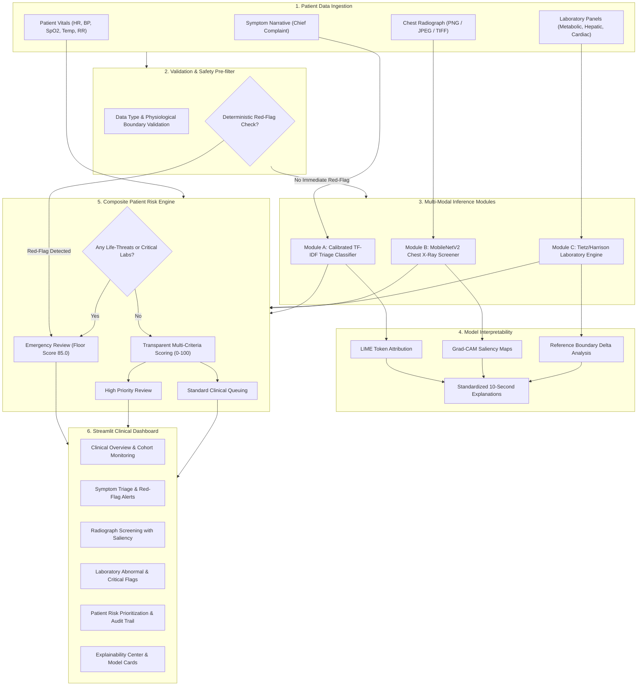

# MediAssist System Architecture & Technical Specifications

## 1. System Philosophy
MediAssist is architected around three foundational healthcare AI principles:
1. **Separation of Concerns:** Each diagnostic modality (NLP symptoms, Computer Vision radiograph screening, Laboratory rules) executes independently and maintains transparent intermediate states.
2. **Deterministic Safety Precedence:** Statistical machine learning models must NEVER override explicit clinical red flags. High-risk life threats automatically force emergency triage.
3. **Clinician-Centric Interpretability:** Every model decision generates a plain-English explanation digestible in under 10 seconds (Finding, Reason, Confidence, Limitation).

---

## 2. Mermaid Architecture Diagram

---

## 3. Data Flow & Contracts

| Module | Input Contract | Output Contract | Model / Technique |
| :--- | :--- | :--- | :--- |
| **Symptom Triage** | Text narrative, duration, severity, age | Urgency class, calibrated probabilities, keywords | Calibrated Logistic Regression + TF-IDF |
| **Chest X-Ray Screener** | 224x224 RGB Radiograph tensor | 6-class pathology probabilities, Grad-CAM heatmap | MobileNetV2 Transfer Learning CNN |
| **Laboratory Interpreter** | Test name, numeric value, unit, sex, age | Status (Normal, Low, High, Critical), Implication | Deterministic Tietz & Harrison Rule Base |
| **Risk Prioritization** | Triage, Vitals, Labs, X-Ray outputs | Priority level, composite score (0-100), audit trail | Weighted Multi-Criteria Priority Matrix |
